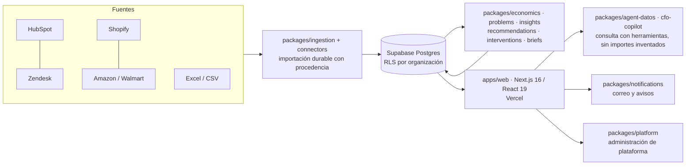

# Rovaq AI

**Inteligencia de ingresos para negocios que venden por marketplaces y atienden por varios canales: convierte conversaciones, pedidos y reembolsos dispersos en problemas cuantificados en dinero, con la evidencia a la vista y una acción recomendada.**

> Antes conocido como Vexa AI. El historial técnico de esa etapa se conserva en [docs/HISTORIAL-ESTADO.md](docs/HISTORIAL-ESTADO.md).

---

## El problema

Un negocio que vende en Amazon, Walmart o Shopify y atiende por HubSpot o Zendesk genera su información más valiosa en lugares que nadie cruza:

- Las **conversaciones** con clientes viven en una herramienta de soporte; los **pedidos** y **reembolsos**, en cada marketplace; los reportes, en hojas de Excel.
- Los **reembolsos que se pudieron reclamar al marketplace** y no se reclamaron son una fuga silenciosa de ingreso: nadie tiene el paquete de evidencia armado a tiempo.
- Los **incumplimientos de SLA** y la carga del equipo son invisibles hasta que el cliente ya se quejó.
- Los reportes que sí existen mezclan monedas, tratan un dato faltante como cero y presentan estimaciones como si fueran hechos. Una decisión sobre dinero no se puede apoyar en eso.

## La solución

Rovaq AI importa el histórico del negocio **conservando de dónde viene cada dato**, identifica los problemas recurrentes, **cuantifica lo que cuestan** y propone acciones con la evidencia delante, hasta el momento de la orden.

1. **Importa con procedencia.** Cada mensaje, pedido y reembolso queda ligado a su fuente, su archivo o su consulta y su fecha de corte. Lo que no se puede rastrear no entra en una cifra.
2. **Identifica problemas.** Agrupa conversaciones en problemas y puntos de dolor, con su volumen por mes y los casos concretos que los sostienen.
3. **Cuantifica la pérdida en ingreso bruto.** Cada número lleva una etiqueta que dice cómo se obtuvo: **Observado** (contado en los datos), **Estimado** (calculado con un supuesto declarado) o **Inferido** (clasificado por IA). Nunca se mezclan sin avisar.
4. **Recomienda acciones con evidencia.** Cada recomendación muestra los casos, el monto y la fuente; la persona decide, y el resultado de la acción se mide después.
5. **Reporte semanal y respuestas.** Un informe ejecutivo semanal y un asistente (**Pregúntale a tus datos**) que responde con datos reales de la organización y muestra los pasos que siguió, no con texto genérico.

## Capacidades actuales

Pantallas del producto (menú del espacio de trabajo, [`apps/web/src/lib/workspace/menu.mjs`](apps/web/src/lib/workspace/menu.mjs)):

| Área | Qué resuelve |
|---|---|
| **Hoy** | Resumen de lo que importa ahora; aviso de datos nuevos; preparar el paquete de reclamo y preguntar en línea. |
| **Cortes publicados** | Cifras económicas fijadas por periodo, moneda y base, con su procedencia. |
| **Problemas** y **Mapa de problemas** | Catálogo de problemas con evidencia, severidad y revisión; vista geográfica. |
| **Puntos de dolor** | Burbujas por tema, detalle con evidencia y exportación CSV sin datos personales. |
| **Carga y SLA** | Carga del equipo y cumplimiento de tiempos de respuesta. |
| **Fuga de reembolsos** | Reembolsos por canal, SKU y moneda, con **paquete de reclamo** listo para presentar. |
| **Acciones** | Por decidir, en curso y resultados: el ciclo completo de una recomendación. |
| **Pregúntale a tus datos / CFO** | Asistente que consulta el libro real de pedidos y reembolsos, problemas y categorías. |
| **Datos y confianza** | Cobertura, fuentes conectadas, importaciones, histórico e identidad, explorador. |
| **Administración** | Equipo y roles, preferencias de avisos, retención y borrado. |

Integraciones y fuentes: **HubSpot**, **Shopify**, **Zendesk**, **Amazon**, **Walmart** y **Excel/CSV** (cada una con su estado real de acceso en *Fuentes conectadas*; ver estado de producción abajo).

Plataforma: **multi-organización** con roles (`owner`, `analyst`, `operator`, `viewer`), **panel de plataforma** interno (`/platform`) para organizaciones, equipos, alertas, procesos, costos de IA y auditoría, **correos y avisos** (plantillas de acceso, invitación, aviso de seguridad, alerta de datos y reporte semanal) y una interfaz **adaptada a celular**.

## Arquitectura



- **Aplicación:** Next.js 16 (App Router) con React 19 y TypeScript, desplegada en Vercel; tareas programadas por cron para sincronizar el CRM y refrescar metadatos ([`apps/web/vercel.json`](apps/web/vercel.json)).
- **Datos:** Supabase (Postgres 17 con **RLS forzado**, Auth y Storage); más de setenta migraciones versionadas en [`supabase/migrations`](supabase/migrations).
- **Dominio:** paquetes en [`packages/`](packages) con pruebas propias; la economía (dinero, monedas, deduplicación) vive en `packages/economics` y es la única fuente de cifras.
- **IA:** sólo clasifica y redacta. **No crea importes ni probabilidades**; los números salen del libro verificable y las respuestas muestran sus pasos.

## Seguridad y privacidad

- **Aislamiento por organización:** RLS forzado en las tablas de negocio; la autorización siempre se decide en el servidor, ocultar un ítem del menú no protege una pantalla.
- **Roles y permisos mínimos:** `owner`, `analyst`, `operator` y `viewer`; el permiso de plataforma es independiente de `owner` y no da lectura de datos de negocio de otros equipos ([administración de plataforma](docs/operations/platform-administration.md)).
- **Auditoría:** las mutaciones de plataforma se registran en el esquema `vexa_platform.audit` en la misma transacción; los cambios de equipo conservan además su propia bitácora.
- **Sin datos personales en exportes:** los CSV de puntos de dolor y de reclamos se construyen sin PII.
- **Secretos sólo en servidor;** el repositorio no incluye credenciales ([entorno](apps/web/ENVIRONMENT.md)).
- **Reglas de datos que no se negocian:** se reporta **ingreso bruto, nunca margen**; **dato desconocido no es cero**; **las monedas nunca se suman entre sí**; toda cifra lleva procedencia y etiqueta Observado / Estimado / Inferido.
- **Planeado, aún no exigido por el producto:** MFA obligatorio para administradores de plataforma, política CSP estricta de la aplicación (hoy hay una política base en [`next.config.ts`](apps/web/next.config.ts)).

## Estado de producción (honesto)

**Lo que existe hoy.** Rovaq AI corre en producción con su **primer cliente, CLIENTEX**, una operación con ventas en marketplaces y soporte sobre HubSpot. El histórico del cliente está cargado con procedencia y las pantallas de arriba operan sobre sus datos reales. No se publican aquí cifras de clientes, ingresos ni tracción: esas métricas no están auditadas para este documento.

**Lo que sigue pendiente** (declarado, no oculto):

- **Respaldos gestionados y recuperación a un punto en el tiempo (PITR):** hoy hay respaldo lógico por organización y procedimiento de restauración probado ([docs/operacion/04-RESPALDOS-Y-RESTAURACION.md](docs/operacion/04-RESPALDOS-Y-RESTAURACION.md)); PITR gestionado no está activado.
- **CSP estricta** y **MFA** para administradores de plataforma (ver Seguridad). El MFA (TOTP) y la consola de superadmin están construidos. Las migraciones de plataforma y lectura de soporte ya están aplicadas; MFA sigue apagado hasta enrolar a los administradores y comprobar recuperación.
- **Correo propio:** SMTP con dominio propio vía Resend; mientras tanto el correo de acceso depende del servicio por defecto, con cupo limitado, y el producto avisa cuando se agota en vez de fingir el envío.
- **Triple análisis de IA** (varios modelos contrastados sobre el mismo caso) para subir la confianza de la clasificación.
- **Accesos de datos de marketplaces:** la lectura directa de Amazon y Walmart depende de las credenciales y autorizaciones de cada cliente; hoy se cubre con exportes.
- **Más clientes y conectores directos:** el diseño es multi-organización; falta el proceso repetible de alta y la lectura directa de más fuentes (Zendesk incluido) con sus accesos.

El detalle de aceptación y la evidencia por fase están en [docs/ESTADO-VIGENTE.md](docs/ESTADO-VIGENTE.md) (parte de él es histórico fechado; cada corte indica su fecha).

## Hoja de ruta de la ronda seed

Uso de fondos, en orden de prioridad y sin cifras comprometidas en este documento:

1. **Confiabilidad de producción:** respaldos con PITR, CSP, MFA, correo propio, monitoreo y alertas de operación.
2. **Segundo y tercer cliente:** conectores directos de Amazon, Walmart y Zendesk, y un proceso repetible de alta de una organización.
3. **Calidad de la IA:** triple análisis, evaluación continua contra casos revisados por personas y control de costo por organización.
4. **Producto:** reclamo asistido de reembolsos de extremo a extremo, medición del resultado de cada acción y reporte semanal configurable.
5. **Equipo:** ingeniería de datos y de producto, y un responsable de éxito con clientes.

## Cómo correrlo localmente

Requisitos: Node.js 22.x ([`package.json`](package.json)) y npm.

```bash
npm ci                      # instala los tres workspaces desde la raíz
# Modo demostración sin Supabase (organización sintética, sólo desarrollo):
VEXA_UI_FIXTURES=1 npm run dev --workspace @vexa/web      # http://localhost:3000
npm run typecheck --workspace @vexa/web                    # next typegen && tsc --noEmit
npm run lint --workspace @vexa/web
```

`VEXA_UI_FIXTURES` es el nombre técnico histórico de la variable de entorno y se mantiene; sólo funciona con `next dev` y nunca en una compilación de producción. Para operar contra Supabase real se requieren las variables de [`apps/web/ENVIRONMENT.md`](apps/web/ENVIRONMENT.md). El build de producción es `npm run build --workspace @vexa/web` y exige `VEXA_BUILD_REVISION` (SHA completo del commit).

## Estructura del repositorio

```text
apps/web/            Aplicación Next.js (pantallas, rutas API, componentes, pruebas)
packages/            Dominio: economics, problems, insights, recommendations, interventions,
                     briefs, agent-datos, cfo-copilot, connectors, ingestion, notifications,
                     platform, team, workspace-service, release, recovery, ...
supabase/            Migraciones, plantillas de correo de Auth, operaciones y pruebas SQL
docs/                Estado vigente, operación (respaldos, runbooks, costos) y diseño
scripts/ ops/        Utilidades de verificación, correos y respaldo/restauración
tests/ support/      Pruebas de aceptación y arneses (parte del registro histórico)
```

Los identificadores técnicos conservan el nombre original del proyecto (`@vexa/*`, esquema `vexa_platform`, variables `VEXA_*`) para no romper despliegues ni datos; la marca visible es Rovaq AI.

## Pruebas

```bash
npm test                                         # kernel económico + fundamentos
npm run test:platform                            # paquete de plataforma
npm run test:agente-ui --workspace @vexa/web     # interfaz del asistente
node --test packages/notifications/tests/*.test.mjs   # correos y plantillas
cd apps/web && node --test tests/*.test.mjs      # contratos de pantallas, marca, menú, contraste
```

La integración continua del repositorio ([`.github/workflows`](.github/workflows)) corre sólo sobre la rama principal.

## Documentación

[Estado vigente](docs/ESTADO-VIGENTE.md) · [Historial de estado](docs/HISTORIAL-ESTADO.md) · [Operación](docs/operacion) · [Administración de plataforma](docs/operations/platform-administration.md) · [Datos vivos](docs/DATOS-VIVOS.md) · [Sistema de interfaz](docs/SISTEMA-UI.md) · [Seguridad](SECURITY.md) · [Cómo contribuir](CONTRIBUTING.md) · [Cambios](CHANGELOG.md)

## Licencia y contacto

**Propietario — todos los derechos reservados.** Este repositorio no concede licencia de uso, copia ni distribución. Para consultas de inversión o de acceso, contactar al fundador, Javier Cámara Porte Petit: javiercamaraportepetit@gmail.com.
