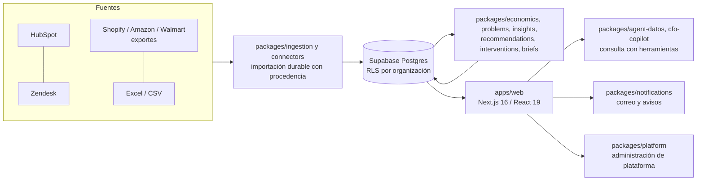

# Rovaq AI

Inteligencia de ingresos para negocios que venden por marketplaces y atienden a sus clientes por varios canales. Cruza conversaciones de soporte, pedidos y reembolsos, agrupa los problemas recurrentes y calcula cuánto dinero cuesta cada uno, con la evidencia a la vista y sin inventar importes.

> Rovaq AI se llamó Vexa AI en una etapa anterior. Los identificadores técnicos conservan el nombre original (paquetes `@vexa/*`, esquema `vexa_platform`, variables `VEXA_*`) para no romper despliegues ni datos.

Este repositorio contiene el código del producto, sus migraciones de base de datos, sus pruebas y la documentación técnica y operativa. **No contiene datos de clientes, credenciales ni material de negocio** (dossier de inversión, estudios de mercado, notas de negociación).

---

## Qué problema resuelve

Un negocio que vende en marketplaces y atiende por una herramienta de soporte genera su información más valiosa en lugares que nadie cruza:

- Las conversaciones con clientes viven en una herramienta de soporte; los pedidos y reembolsos, en cada marketplace; los reportes, en hojas de cálculo.
- Los reembolsos que se podían reclamar al marketplace y no se reclamaron son una fuga silenciosa de ingreso.
- Los reportes que existen suelen mezclar monedas, tratar un dato faltante como cero y presentar estimaciones como hechos.

Rovaq AI importa el histórico conservando de dónde viene cada dato, identifica los problemas, cuantifica su costo con una etiqueta de procedencia (**Observado**, **Estimado** o **Inferido**) y propone acciones cuyo resultado se mide después.

## Estado del producto (honesto)

Resumen: el producto está construido y probado de forma automatizada, y existe un despliegue en producción con un cliente piloto. **No es todavía un producto listo para operar con múltiples clientes sin acompañamiento.** No se publican aquí cifras de clientes, ingresos ni tracción: no están auditadas para este documento.

| Área | Estado | Detalle |
|---|---|---|
| Aplicación web (`apps/web`) | Implementada | Next.js 16 / React 19 / TypeScript. Decenas de pantallas del espacio de trabajo, consola de plataforma, sitio público y rutas API. |
| Base de datos (`supabase/`) | Implementada | Postgres con RLS por organización, más de cien migraciones versionadas, plantillas de correo de Auth. |
| Importación con procedencia | Implementada | Carga de CSV/Excel y lectura de HubSpot con checkpoints; cada registro conserva su fuente y fecha de corte. |
| Cálculo económico | Implementado | `packages/economics`: dinero exacto, monedas separadas, dato desconocido distinto de cero, deduplicación y reversos. |
| Problemas, recomendaciones y acciones | Implementado | Agrupación de conversaciones, evidencia, recomendaciones y ciclo de intervención con medición. |
| Asistente "Pregúntale a tus datos" y CFO | Implementado | Consulta herramientas sobre el libro de pedidos y reembolsos; la IA clasifica y redacta, no genera importes. |
| Conector HubSpot | Implementado | Lectura acotada y sincronización periódica. |
| Conector Zendesk | Parcial | Código de lectura y pruebas; sin acceso de producción conectado. |
| Shopify, Amazon, Walmart | Parcial | Cargas desde archivos de exportación; no hay lectura directa por API de Amazon ni Walmart. |
| Roles y administración de plataforma | Implementado | `owner`, `analyst`, `operator`, `viewer`; consola `/platform` con auditoría. |
| MFA para administradores de plataforma | Construido, apagado por defecto | Falta enrolar administradores y comprobar la recuperación antes de exigirlo. |
| Política CSP estricta | No implementada | La política completa solo corre en modo de reporte (`Content-Security-Policy-Report-Only`); en modo obligatorio solo se aplican `base-uri`, `object-src` y `frame-ancestors` (`apps/web/next.config.ts`). Ver `docs/seguridad/CSP-NONCES-EVALUACION.md`. |
| Respaldos y recuperación | Parcial | Hay herramientas de respaldo y restauración verificada en entorno local (`ops/backup-restore`). No se ha ensayado una restauración completa de producción ni se ha medido el tiempo de recuperación. |
| Correo transaccional con dominio propio | Pendiente | Mientras tanto el correo de acceso depende del servicio por defecto del proveedor, con cupo limitado. |
| Multi-organización a escala | Diseñado, no probado en producción | El modelo de datos es multi-organización; falta un proceso repetible de alta de clientes. |

## Arquitectura



Más detalle en [docs/ARQUITECTURA.md](docs/ARQUITECTURA.md).

**Stack.** Node.js 22, Next.js 16 (App Router), React 19, TypeScript 5.9, Postgres 17 en Supabase (Auth, Storage, RLS), paquetes de dominio en JavaScript (`.mjs`) con tipos `.d.mts`, `node:test` como ejecutor de pruebas. La IA se consume a través de un gateway propio (`packages/gateway`) con presupuesto por organización.

**Reglas de datos que no se negocian.** Se reporta ingreso bruto, nunca margen. Un dato desconocido no es cero. Las monedas nunca se suman entre sí. Toda cifra lleva procedencia y etiqueta Observado / Estimado / Inferido. La IA no crea importes ni probabilidades.

## Seguridad y privacidad

- Aislamiento por organización con RLS forzado en las tablas de negocio; la autorización se decide siempre en el servidor, ocultar un ítem del menú no protege una pantalla.
- El permiso de plataforma es independiente del rol `owner` y no da lectura de datos de negocio de otras organizaciones ([administración de plataforma](docs/operations/platform-administration.md)).
- Las mutaciones de plataforma se auditan en la misma transacción (`vexa_platform.audit`).
- Los exportes (CSV de puntos de dolor y de reclamos) se construyen sin datos personales.
- Los secretos solo existen en el servidor; el repositorio no incluye credenciales ([entorno](apps/web/ENVIRONMENT.md)).
- Una prueba automática ([`tests/seguridad/datos-de-cliente.test.mjs`](tests/seguridad/datos-de-cliente.test.mjs)) falla si reaparecen datos de un cliente en archivos versionados. Política en [docs/seguridad/DATOS-DE-CLIENTE.md](docs/seguridad/DATOS-DE-CLIENTE.md).
- Reporte de vulnerabilidades: [SECURITY.md](SECURITY.md).

## Cómo correrlo y probarlo

Requisitos: Node.js 22.x y npm. Algunas pruebas de base de datos requieren PostgreSQL 17 local (`initdb`) y las de aceptación de plataforma además Docker y servicios locales de Auth; sin ellos se omiten o fallan.

```bash
npm ci                                              # instala los workspaces desde la raíz

# Modo demostración sin Supabase (organización sintética, solo desarrollo):
VEXA_UI_FIXTURES=1 npm run dev --workspace @vexa/web   # http://localhost:3000
npm run typecheck                                   # tipos de apps/web
npm run lint --workspace @vexa/web
```

`VEXA_UI_FIXTURES` es el nombre técnico histórico de la variable y se mantiene; solo funciona con `next dev` y nunca en una compilación de producción. Para operar contra Supabase se requieren las variables de [`apps/web/ENVIRONMENT.md`](apps/web/ENVIRONMENT.md). El build de producción es `npm run build --workspace @vexa/web` y exige `VEXA_BUILD_REVISION` (SHA completo del commit).

```bash
npm test                  # núcleo económico + guarda de datos de cliente + sitio público
npm run test:paquetes     # paquetes de dominio, rutas de la aplicación, utilidades
npm run test:aceptacion   # pruebas de aceptación de la plataforma (varias requieren PostgreSQL 17 local)
npm run test:web-ui       # pruebas de interfaz con tsx (asistente, onboarding, CCO, i18n)
npm run test:mutations    # sonda de mutaciones del núcleo económico
```

Las pruebas de un área concreta se corren con los scripts `test:<área>` de [`package.json`](package.json).

**Estado de las pruebas, dicho sin adornos.** En la corrida de verificación de la limpieza de este repositorio (31 de octubre de 2026) pasaron completas `npm test` (núcleo económico, guarda de datos de cliente y sitio público) y `npm run test:web-ui`. `npm run test:paquetes` tuvo fallos preexistentes en pruebas que necesitan PostgreSQL 17 local o que miden rendimiento y dependen de la carga de la máquina. Las pruebas de aceptación de plataforma (`test:aceptacion`) no corren sin Docker y los servicios locales; la del núcleo económico y la de lectura de CSV/Excel (`F02-01`) sí.

## Estructura del repositorio

```text
apps/web/     Aplicación Next.js: pantallas, rutas API, componentes, sitio público y pruebas
packages/     Dominio: economics, problems, insights, recommendations, interventions, briefs,
              agent-datos, cfo-copilot, connectors, ingestion, notifications, platform, team,
              workspace-service, gateway, jobs, release, recovery, ...
supabase/     Migraciones, plantillas de correo de Auth, operaciones y pruebas SQL
ops/          Respaldo y restauración verificada, diagnósticos SQL, reversa de migraciones, programación
scripts/      Cargas y verificaciones de datos, utilidades de correo
config/       Configuración de cliente piloto (solo ejemplo genérico; los datos reales son locales y se ignoran)
tests/        Pruebas de aceptación de la plataforma, guarda de datos de cliente, utilidades de prueba
tools/        Herramientas del sitio público (presupuesto de peso, capturas)
docs/         Seguridad, operación (runbooks, respaldos, rollback) y notas de diseño de producto
.github/      Flujos de integración continua
```

## Documentación

[Arquitectura](docs/ARQUITECTURA.md) · [Seguridad](docs/seguridad) · [Operación](docs/operacion) · [Administración de plataforma](docs/operations/platform-administration.md) · [Sistema de interfaz](docs/SISTEMA-UI.md) · [Entorno de la aplicación](apps/web/ENVIRONMENT.md) · [Cómo contribuir](CONTRIBUTING.md) · [Cambios](CHANGELOG.md)

## Licencia y contacto

**Propietario, todos los derechos reservados** ([LICENSE](LICENSE)). Este repositorio es visible públicamente pero no concede licencia de uso, copia, modificación ni distribución.

Contacto: Javier Cámara Porte Petit, fundador, javiercamaraportepetit@gmail.com.
